# Testing Strategy

<cite>
**Referenced Files in This Document**   
- [README.md](file://README.md)
- [pubspec.yaml](file://pubspec.yaml)
- [package.json](file://server/package.json)
- [.github/workflows/server-ci.yml](file://.github/workflows/server-ci.yml)
- [test/fake_repositories.dart](file://test/fake_repositories.dart)
- [test/booking_flow_test.dart](file://test/booking_flow_test.dart)
- [test/session_controller_test.dart](file://test/session_controller_test.dart)
- [test/layout_overflow_test.dart](file://test/layout_overflow_test.dart)
- [test/layout_overflow_components_test.dart](file://test/layout_overflow_components_test.dart)
- [test/layout_overflow_extended_test.dart](file://test/layout_overflow_extended_test.dart)
- [test/layout_overflow_sheets_test.dart](file://test/layout_overflow_sheets_test.dart)
- [test/support/overflow_harness.dart](file://test/support/overflow_harness.dart)
- [docs/superpowers/plans/2026-10-29-flutter-overflow-suite-green.md](file://docs/superpowers/plans/2026-10-29-flutter-overflow-suite-green.md)
- [server/src/tests/util.ts](file://server/src/tests/util.ts)
- [server/src/tests/money.integration.test.ts](file://server/src/tests/money.integration.test.ts)
- [server/src/tests/safety.integration.test.ts](file://server/src/tests/safety.integration.test.ts)
</cite>

## Update Summary
**Changes Made**   
- Added comprehensive layout overflow testing infrastructure with matrix testing approach
- Documented new overflow detection harness and utilities for accessibility compliance
- Updated Flutter frontend testing section to include responsive layout validation
- Added detailed coverage of viewport size and text scale factor testing
- Enhanced troubleshooting guide with overflow-specific guidance

## Table of Contents
1. [Introduction](#introduction)
2. [Project Structure](#project-structure)
3. [Core Components](#core-components)
4. [Architecture Overview](#architecture-overview)
5. [Detailed Component Analysis](#detailed-component-analysis)
6. [Dependency Analysis](#dependency-analysis)
7. [Performance Considerations](#performance-considerations)
8. [Troubleshooting Guide](#troubleshooting-guide)
9. [Conclusion](#conclusion)

## Introduction
This document describes the testing strategy for DineCircle, covering both the Flutter frontend and the Express backend. It explains how unit tests validate widgets, providers, session state, and business logic; how integration tests exercise user flows and API endpoints against a real PostgreSQL database; how fake repositories and test doubles isolate client behavior; and how continuous integration validates type safety, schema setup, and write paths. 

**Updated** The testing strategy now includes comprehensive layout overflow detection through matrix testing across multiple viewport sizes (320px to 600px) and text scale factors (1.0x to 2.0x) to ensure accessibility compliance and responsive design validation.

## Project Structure
The repository is a monorepo with two primary testing surfaces:

- **Flutter frontend**: Tests live under `test/` and use `flutter_test`. They are offline, widget-focused, and driven by Riverpod overrides and fake repositories. The frontend now includes extensive layout overflow testing infrastructure.
- **Express backend**: Integration tests live under `server/src/tests/` and run against a freshly created, isolated PostgreSQL database using Node's built-in test runner via `tsx --test`.

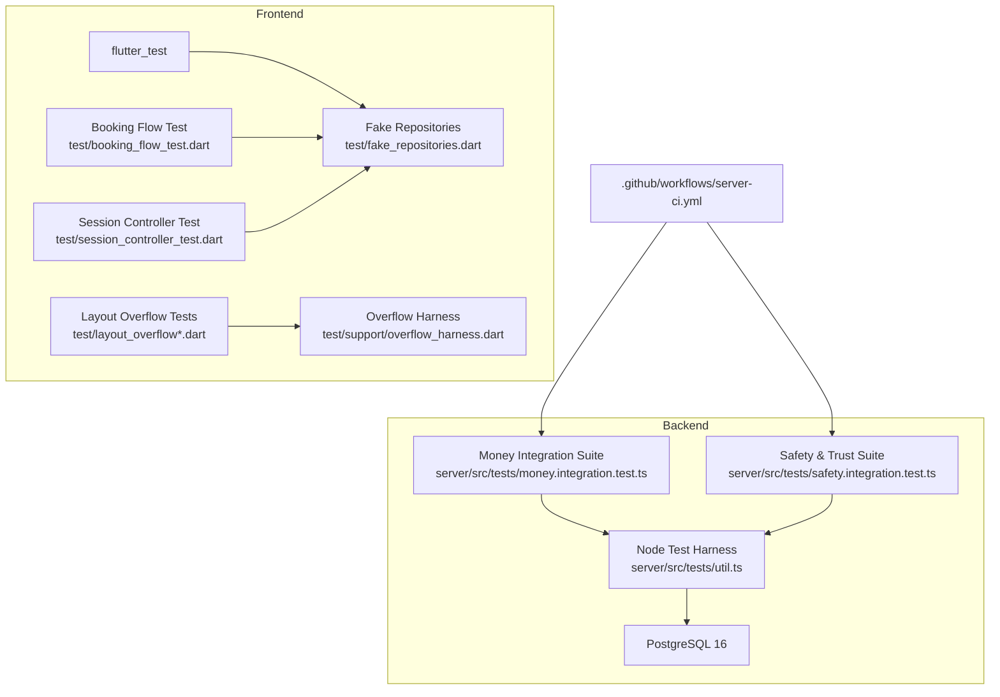

**Diagram sources**
- [test/fake_repositories.dart:1-800](file://test/fake_repositories.dart#L1-L800)
- [test/booking_flow_test.dart:1-169](file://test/booking_flow_test.dart#L1-L169)
- [test/session_controller_test.dart:1-327](file://test/session_controller_test.dart#L1-L327)
- [test/layout_overflow_test.dart:1-485](file://test/layout_overflow_test.dart#L1-L485)
- [test/support/overflow_harness.dart:1-93](file://test/support/overflow_harness.dart#L1-L93)
- [server/src/tests/util.ts:1-233](file://server/src/tests/util.ts#L1-L233)
- [server/src/tests/money.integration.test.ts:1-598](file://server/src/tests/money.integration.test.ts#L1-L598)
- [server/src/tests/safety.integration.test.ts:1-735](file://server/src/tests/safety.integration.test.ts#L1-L735)
- [.github/workflows/server-ci.yml:1-245](file://.github/workflows/server-ci.yml#L1-L245)

**Section sources**
- [README.md:270-299](file://README.md#L270-L299)
- [README.md:593-627](file://README.md#L593-L627)

## Core Components
The testing system is built around five core components:

1. **Flutter fake repositories and storage fakes**
   - Provide deterministic data, controllable errors, call counters, and last-call inspection for repositories such as events, bookings, users, restaurants, chat, hosts, offers, social, and session.
   - Include an in-memory implementation of secure storage to avoid platform channels during tests.

2. **Flutter widget and provider tests**
   - Use `flutter_test`, `ProviderScope`, and provider overrides to render screens and controllers without network or persistent storage.
   - Exercise checkout flows, promo code forwarding, error display, session bootstrap, sign-up/sign-out, account lifecycle, settings updates, email change, logout-all, and delete-account behaviors.

3. **Comprehensive layout overflow testing infrastructure**
   - Matrix testing approach covering multiple viewport sizes (320px, 360px, 390px, 430px, 600px) and text scale factors (1.0x, 1.3x, 2.0x).
   - Dedicated overflow capture mechanism that treats RenderFlex overflow as test failures.
   - Shared harness utilities for viewport manipulation, text scaling, and keyboard simulation.

4. **Backend integration test harness**
   - Creates an isolated PostgreSQL database per test file, applies schema and seed, starts the real Express server on a free port, waits for health, and exposes helpers for direct SQL assertions.
   - Provides utilities for spawning alternate API instances (for example, with different configuration), finding free ports, and running child scripts.

5. **Feature-specific integration suites**
   - Money path suite covers accrual, refunds, cancellations, declines, approvals, promo discounts, withdrawals, authorization, concurrency, rollback, event deletion guards, simulated-only money, and configurable commission.
   - Safety & trust suite covers blocks, follow severance, discovery/profile hiding, booking/chat enforcement, reports, feedback, moderation, and regression checks across auth, discovery, follows, bookings, Host Studio, and wallet.

**Section sources**
- [test/fake_repositories.dart:1-800](file://test/fake_repositories.dart#L1-L800)
- [test/booking_flow_test.dart:1-169](file://test/booking_flow_test.dart#L1-L169)
- [test/session_controller_test.dart:1-327](file://test/session_controller_test.dart#L1-L327)
- [test/layout_overflow_test.dart:30-108](file://test/layout_overflow_test.dart#L30-L108)
- [test/support/overflow_harness.dart:1-93](file://test/support/overflow_harness.dart#L1-L93)
- [server/src/tests/util.ts:1-233](file://server/src/tests/util.ts#L1-L233)
- [server/src/tests/money.integration.test.ts:1-598](file://server/src/tests/money.integration.test.ts#L1-L598)
- [server/src/tests/safety.integration.test.ts:1-735](file://server/src/tests/safety.integration.test.ts#L1-L735)

## Architecture Overview
The testing architecture separates concerns between fast, offline frontend tests, comprehensive layout validation, and slower, database-backed backend integration tests.

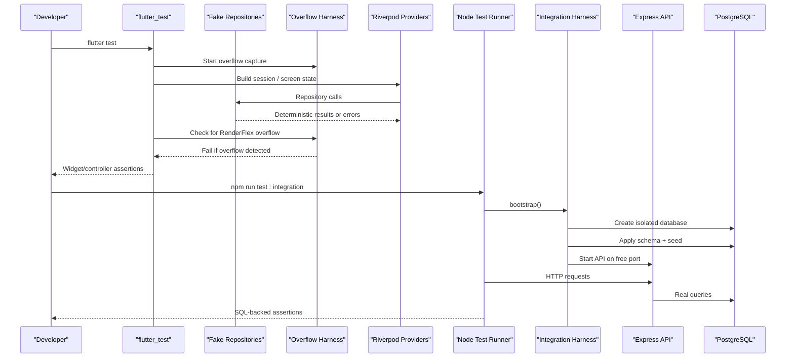

**Diagram sources**
- [test/fake_repositories.dart:1-800](file://test/fake_repositories.dart#L1-L800)
- [test/support/overflow_harness.dart:32-44](file://test/support/overflow_harness.dart#L32-L44)
- [server/src/tests/util.ts:1-233](file://server/src/tests/util.ts#L1-L233)
- [server/src/tests/money.integration.test.ts:1-598](file://server/src/tests/money.integration.test.ts#L1-L598)
- [server/src/tests/safety.integration.test.ts:1-735](file://server/src/tests/safety.integration.test.ts#L1-L735)

## Detailed Component Analysis

### Frontend Unit Testing Strategy

#### Fake Repositories and Test Doubles
The fake repository layer implements the same interfaces used by production repositories. Each fake supports:

- Configurable return values for reads.
- Optional delays and thrown errors to exercise failure paths.
- Call counters and last-call inspection for writes.
- Deterministic fixtures for domain models such as dinners, bookings, reviews, restaurants, and users.

Key patterns include:

- A generic `_gate()` method that enforces optional delay and error behavior before returning data.
- Per-method counters like `feedCalls`, `joinCalls`, `cancelCalls`, `checkInCalls`, `publishCalls`, `patchEventCalls`, `mineCalls`, `updateMeCalls`, `patchSettingsCalls`, and many more.
- An in-memory secure storage implementation that avoids platform channel calls while preserving read/write/delete semantics.

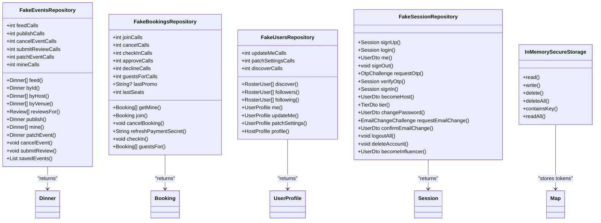

**Diagram sources**
- [test/fake_repositories.dart:118-264](file://test/fake_repositories.dart#L118-L264)
- [test/fake_repositories.dart:266-324](file://test/fake_repositories.dart#L266-L324)
- [test/fake_repositories.dart:326-427](file://test/fake_repositories.dart#L326-L427)
- [test/fake_repositories.dart:429-464](file://test/fake_repositories.dart#L429-L464)
- [test/fake_repositories.dart:466-716](file://test/fake_repositories.dart#L466-L716)
- [test/fake_repositories.dart:718-800](file://test/fake_repositories.dart#L718-L800)

**Section sources**
- [test/fake_repositories.dart:1-800](file://test/fake_repositories.dart#L1-L800)

#### Checkout and Booking Flow Tests
The booking flow test renders the checkout screen inside a `ProviderScope`, overrides the session controller with a signed-in stub, and injects a `FakeBookingsRepository`. It verifies:

- Exactly one repository join call occurs when the user submits payment.
- The number of seats forwarded matches the UI selection.
- The completed booking returned from the fake has expected identifiers and status.
- Promo codes entered in the UI are forwarded to the repository so the server remains the authority for pricing.
- Server errors surface inline and prevent completion.

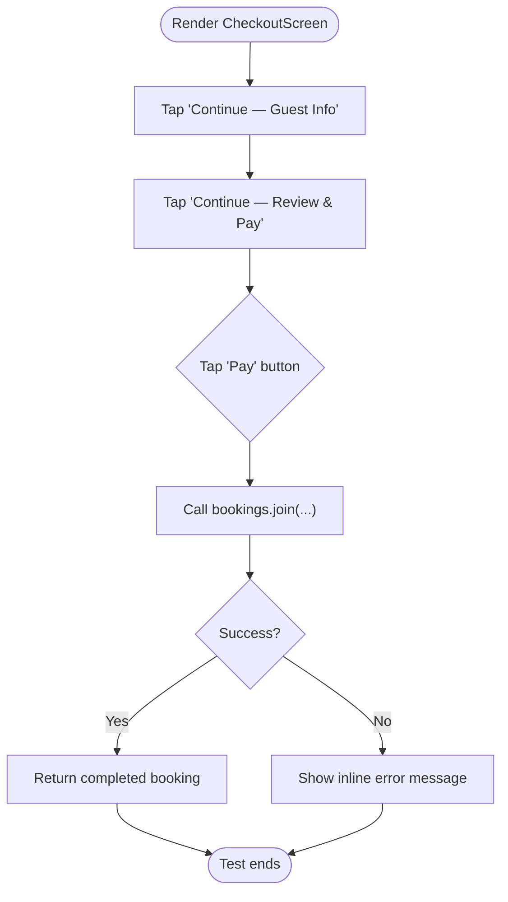

**Diagram sources**
- [test/booking_flow_test.dart:48-79](file://test/booking_flow_test.dart#L48-L79)
- [test/booking_flow_test.dart:81-169](file://test/booking_flow_test.dart#L81-L169)

**Section sources**
- [test/booking_flow_test.dart:1-169](file://test/booking_flow_test.dart#L1-L169)

#### Session Controller and Account Lifecycle Tests
Session tests validate the full authentication and account lifecycle without touching secure storage or the network:

- Starting signed out when no token is stored.
- Signing up persists a fake token and publishes a profile.
- Restoring a signed-in session from a stored token.
- Rejecting a stale token clears it and returns to signed out.
- Signing out clears state and storage.
- Updating settings republishes the session and preserves email.
- Changing password keeps the device signed in unless the current password is wrong.
- Email change requires confirmation before applying.
- Logout all devices clears the session even if the remote call fails.
- Delete account clears the session after success but keeps it on failure.

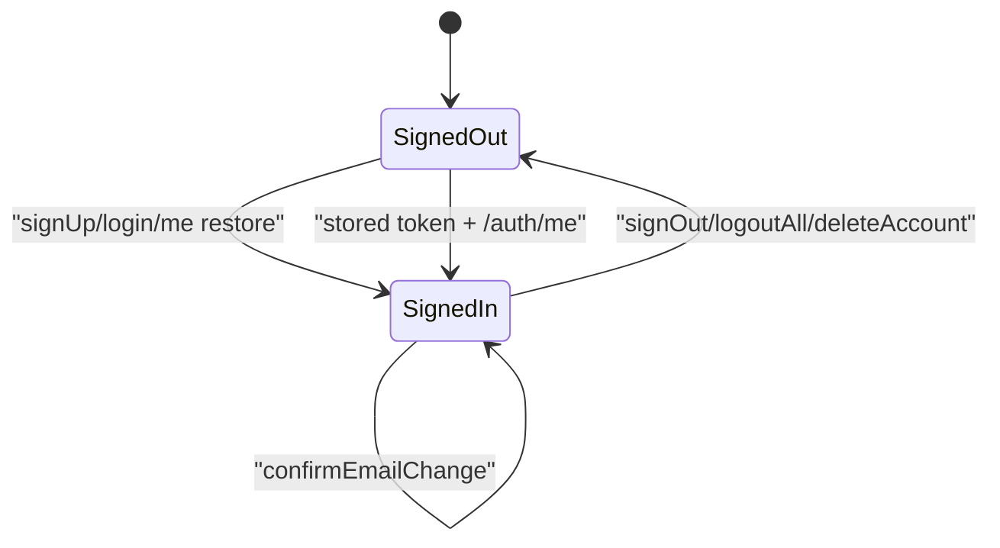

**Diagram sources**
- [test/session_controller_test.dart:14-126](file://test/session_controller_test.dart#L14-L126)
- [test/session_controller_test.dart:128-327](file://test/session_controller_test.dart#L128-L327)

**Section sources**
- [test/session_controller_test.dart:1-327](file://test/session_controller_test.dart#L1-L327)

#### Comprehensive Layout Overflow Testing Infrastructure

**Updated** The application now includes a sophisticated layout overflow testing system that ensures accessibility compliance and responsive design validation across multiple device configurations.

##### Overflow Detection Harness
The overflow detection system uses a matrix testing approach that validates UI components across:

- **Viewport sizes**: 320px, 360px, 390px, 430px, 600px (small phone → phablet → tablet)
- **Text scale factors**: 1.0x (default), 1.3x (accessibility), 2.0x (maximum accessibility)
- **Keyboard states**: Simulated software keyboard with 300px bottom inset

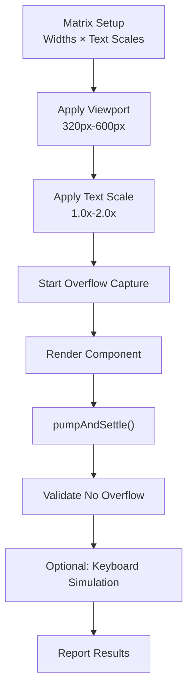

**Diagram sources**
- [test/support/overflow_harness.dart:15-19](file://test/support/overflow_harness.dart#L15-L19)
- [test/layout_overflow_test.dart:106-108](file://test/layout_overflow_test.dart#L106-L108)

##### Key Components

**OverflowCapture Class**: Captures `RenderFlex overflowed` messages and treats them as test failures rather than warnings.

**Shared Utilities**:
- `applyViewport()`: Sets logical viewport dimensions with realistic device pixel ratio (3x)
- `applyTextScale()`: Applies accessibility text scaling
- `applyKeyboardInset()`: Simulates software keyboard presence
- `startOverflowCapture()`: Initializes overflow error collection
- `expectNoOverflow()`: Fails test if any overflow was detected

**Test Organization**:
- `layout_overflow_test.dart`: Core screen validation (Home, Bookings, Detail, Create, Explore, Profile, Saved, Notifications, HostDashboard, People)
- `layout_overflow_components_test.dart`: Reusable widget validation (buttons, cards, avatars, app shell)
- `layout_overflow_extended_test.dart`: Extended screen coverage (auth, checkout, settings, safety, analytics)
- `layout_overflow_sheets_test.dart`: Modal sheet validation with proper Material context

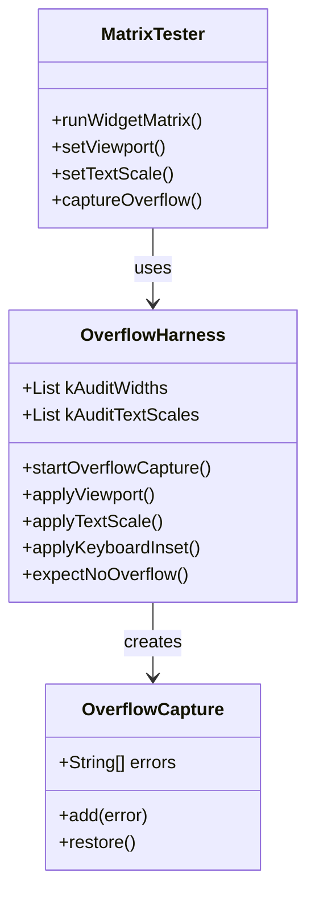

**Diagram sources**
- [test/support/overflow_harness.dart:22-84](file://test/support/overflow_harness.dart#L22-L84)
- [test/layout_overflow_components_test.dart:69-102](file://test/layout_overflow_components_test.dart#L69-L102)

**Section sources**
- [test/layout_overflow_test.dart:30-108](file://test/layout_overflow_test.dart#L30-L108)
- [test/layout_overflow_components_test.dart:30-102](file://test/layout_overflow_components_test.dart#L30-L102)
- [test/layout_overflow_extended_test.dart:49-134](file://test/layout_overflow_extended_test.dart#L49-L134)
- [test/layout_overflow_sheets_test.dart:21-101](file://test/layout_overflow_sheets_test.dart#L21-L101)
- [test/support/overflow_harness.dart:1-93](file://test/support/overflow_harness.dart#L1-L93)

### Backend Integration Testing Strategy

#### Test Harness and Utilities
The backend harness provides a repeatable environment for integration tests:

- Sets `DATABASE_URL` to an isolated test database name.
- Creates and drops a unique database per test file.
- Applies schema and seed through child processes.
- Starts the real Express server on a free port.
- Waits for `/api/health` before allowing tests to proceed.
- Exposes helpers for direct SQL queries: `one`, `many`, `exec`.
- Supports spawning alternate API instances with different configuration, such as a different commission rate.

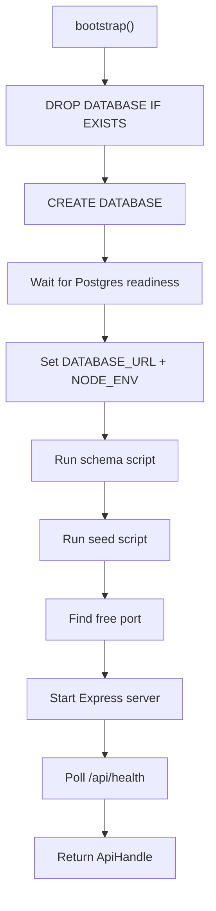

**Diagram sources**
- [server/src/tests/util.ts:33-43](file://server/src/tests/util.ts#L33-L43)
- [server/src/tests/util.ts:68-80](file://server/src/tests/util.ts#L68-L80)
- [server/src/tests/util.ts:93-107](file://server/src/tests/util.ts#L93-L107)
- [server/src/tests/util.ts:110-164](file://server/src/tests/util.ts#L110-L164)
- [server/src/tests/util.ts:170-197](file://server/src/tests/util.ts#L170-L197)
- [server/src/tests/util.ts:199-233](file://server/src/tests/util.ts#L199-L233)

**Section sources**
- [server/src/tests/util.ts:1-233](file://server/src/tests/util.ts#L1-L233)

#### Money Path Integration Suite
The money suite exercises financial correctness end-to-end:

- Check-in accrues host earnings based on captured seats.
- Cancellation after accrual books a refund and heals the payout.
- Cancellation before accrual releases seats and seeds no payout.
- Repeated cancellation requests are refused without ledger drift.
- Host decline of an authorized hold releases the hold without moving money.
- Approval captures the hold and allows normal accrual.
- Refunds follow the captured discounted amount.
- Withdrawals validate against the live balance and reject over-balance attempts.
- Cross-user authorization rejects foreign actors.
- Concurrent last-seat bookings never oversell.
- Concurrent withdrawals cannot double-spend.
- Mid-transaction failures roll back the entire operation.
- Events with financial history cannot be deleted until cleared.
- Simulated money never becomes a real payout.
- Commission is configurable rather than hardcoded.

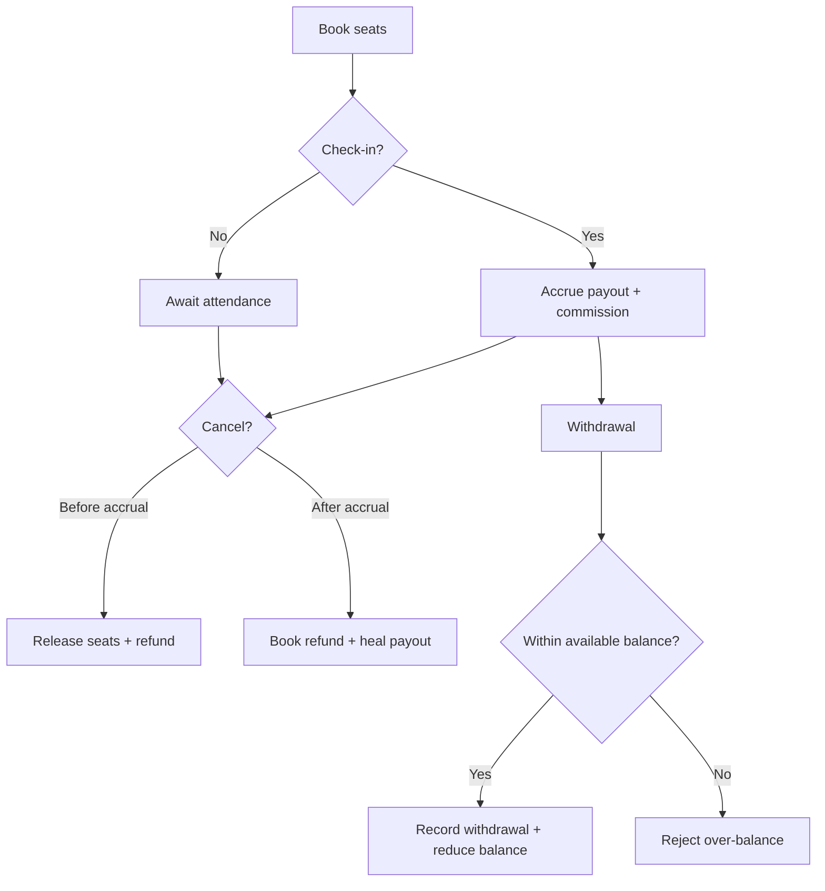

**Diagram sources**
- [server/src/tests/money.integration.test.ts:139-179](file://server/src/tests/money.integration.test.ts#L139-L179)
- [server/src/tests/money.integration.test.ts:181-222](file://server/src/tests/money.integration.test.ts#L181-L222)
- [server/src/tests/money.integration.test.ts:224-274](file://server/src/tests/money.integration.test.ts#L224-L274)
- [server/src/tests/money.integration.test.ts:276-309](file://server/src/tests/money.integration.test.ts#L276-L309)
- [server/src/tests/money.integration.test.ts:311-327](file://server/src/tests/money.integration.test.ts#L311-L327)
- [server/src/tests/money.integration.test.ts:329-344](file://server/src/tests/money.integration.test.ts#L329-L344)
- [server/src/tests/money.integration.test.ts:346-386](file://server/src/tests/money.integration.test.ts#L346-L386)
- [server/src/tests/money.integration.test.ts:413-471](file://server/src/tests/money.integration.test.ts#L413-L471)
- [server/src/tests/money.integration.test.ts:473-518](file://server/src/tests/money.integration.test.ts#L473-L518)
- [server/src/tests/money.integration.test.ts:520-593](file://server/src/tests/money.integration.test.ts#L520-L593)

**Section sources**
- [server/src/tests/money.integration.test.ts:1-598](file://server/src/tests/money.integration.test.ts#L1-L598)

#### Safety and Trust Integration Suite
The safety suite validates security-sensitive features:

- Block guards refuse self-block, unknown accounts, deleted accounts, and unauthenticated requests.
- Blocking removes mutual follows, prevents new follows, and is idempotent.
- Unblock lifts restrictions but does not restore follows.
- Blocked pairs disappear from discovery and receive 403 on direct profile reads.
- Blocked users cannot join new events, but existing tickets remain usable.
- Blocked pairs cannot post new messages in event chat, while history remains readable.
- Reports support multiple targets, evidence snapshots, duplicate guards, self-report rejection, reporter privacy, and admin moderation.
- Feedback supports categories, validation, persistence, ownership, and admin triage.
- Regression tests ensure auth, discovery, follow/unfollow, booking, Host Studio, and wallet continue working.

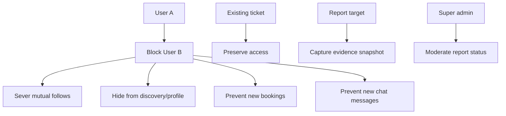

**Diagram sources**
- [server/src/tests/safety.integration.test.ts:104-130](file://server/src/tests/safety.integration.test.ts#L104-L130)
- [server/src/tests/safety.integration.test.ts:132-207](file://server/src/tests/safety.integration.test.ts#L132-L207)
- [server/src/tests/safety.integration.test.ts:209-254](file://server/src/tests/safety.integration.test.ts#L209-L254)
- [server/src/tests/safety.integration.test.ts:256-317](file://server/src/tests/safety.integration.test.ts#L256-L317)
- [server/src/tests/safety.integration.test.ts:319-377](file://server/src/tests/safety.integration.test.ts#L319-L377)
- [server/src/tests/safety.integration.test.ts:379-596](file://server/src/tests/safety.integration.test.ts#L379-L596)
- [server/src/tests/safety.integration.test.ts:598-694](file://server/src/tests/safety.integration.test.ts#L598-L694)
- [server/src/tests/safety.integration.test.ts:696-735](file://server/src/tests/safety.integration.test.ts#L696-L735)

**Section sources**
- [server/src/tests/safety.integration.test.ts:1-735](file://server/src/tests/safety.integration.test.ts#L1-L735)

## Dependency Analysis
Testing dependencies can be understood at three levels:

1. **Flutter test dependencies**
   - `flutter_test` is declared as a dev dependency.
   - Tests depend on application packages such as Riverpod, Dio, secure storage, and theme/model layers through imports.
   - Fake repositories replace production repositories and secure storage.
   - New overflow testing infrastructure adds shared utilities for responsive validation.

2. **Backend test dependencies**
   - The backend uses Node's built-in test runner through `tsx --test`.
   - Integration tests depend on `pg` for direct database assertions.
   - The harness spawns child processes for schema and seed execution.

3. **Continuous integration dependencies**
   - GitHub Actions runs Node 24, installs dependencies, typechecks, applies schema and seed, starts the server, and executes a curl-based smoke flow against Postgres 16.

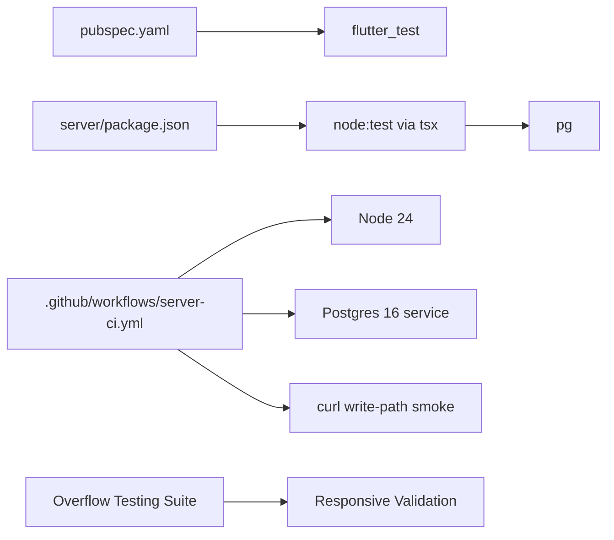

**Diagram sources**
- [pubspec.yaml:49-58](file://pubspec.yaml#L49-L58)
- [package.json:6-15](file://server/package.json#L6-L15)
- [package.json:17-35](file://server/package.json#L17-L35)
- [.github/workflows/server-ci.yml:1-34](file://.github/workflows/server-ci.yml#L1-L34)
- [.github/workflows/server-ci.yml:35-69](file://.github/workflows/server-ci.yml#L35-L69)

**Section sources**
- [pubspec.yaml:49-58](file://pubspec.yaml#L49-L58)
- [package.json:6-15](file://server/package.json#L6-L15)
- [.github/workflows/server-ci.yml:1-245](file://.github/workflows/server-ci.yml#L1-L245)

## Performance Considerations
The current testing strategy prioritizes correctness and isolation over performance benchmarking:

- **Frontend tests** are widget-level and offline. They do not measure rendering performance, memory usage, or frame budgets.
- **Layout overflow tests** focus on accessibility compliance and responsive design validation across multiple viewport sizes and text scales.
- **Backend integration tests** assert database rows and HTTP responses but do not perform load testing or latency profiling.
- **CI smoke tests** validate critical write paths but do not simulate sustained traffic.

Recommended performance and load testing additions:

- Add Flutter performance tests using `flutter_driver` or `integration_test` to measure frame times, layout stability, and navigation costs for complex screens such as checkout, host dashboard, and analytics.
- Add backend load tests using tools like k6, Artillery, or autocannon to validate booking concurrency, seat locking, withdrawal contention, and rate limiting under realistic load.
- Add database-level performance checks for high-cardinality queries in events, bookings, payouts, refunds, reports, and feedback.
- Add synthetic monitoring for `/api/health`, `/api/auth/me`, booking creation, and Host Studio endpoints.
- Add memory and CPU profiling for long-running server processes and heavy Flutter screens.

[No sources needed since this section provides general guidance]

## Troubleshooting Guide

### Flutter Test Issues
Common issues and resolutions:

- **Platform channel failures**: Use `InMemorySecureStorage` instead of real secure storage.
- **Network failures**: Override repositories with fakes that return deterministic data or controlled errors.
- **Layout overflow warnings**: Tests tolerate `RenderFlex` overflow warnings where appropriate.
- **Async timing**: Use `pumpAndSettle` for stable state and small `pump` calls for spinner transitions.
- **Provider state**: Always dispose `ProviderContainer` in teardown.

**Updated** Layout overflow testing issues:

- **RenderFlex overflow failures**: These are intentional test failures indicating responsive design problems. Fix by making content scrollable, ellipsizing text, or using flexible layouts.
- **Material ancestor missing**: Bottom sheets must be opened through proper `show*Sheet()` methods, not mounted directly as `MaterialApp.home`.
- **Keyboard overlap issues**: Use `SingleChildScrollView` in sheets with forms, and ensure proper `viewInsets` handling.
- **Text scaling problems**: Ensure text elements use `maxLines: 1` with `overflow: TextOverflow.ellipsis` for long labels.

**Section sources**
- [test/fake_repositories.dart:429-464](file://test/fake_repositories.dart#L429-L464)
- [test/booking_flow_test.dart:24-46](file://test/booking_flow_test.dart#L24-L46)
- [test/session_controller_test.dart:14-23](file://test/session_controller_test.dart#L14-L23)
- [test/layout_overflow_test.dart:43-55](file://test/layout_overflow_test.dart#L43-L55)
- [test/layout_overflow_sheets_test.dart:21-27](file://test/layout_overflow_sheets_test.dart#L21-L27)

### Backend Integration Test Issues
Common issues and resolutions:

- **Database connection failures**: Ensure Postgres is reachable and `DATABASE_URL` points to the isolated test database.
- **Schema or seed failures**: Verify schema and seed scripts run successfully before starting the server.
- **Server startup failures**: Check health endpoint polling and child process logs.
- **Port collisions**: Use the provided free-port utility rather than hardcoding ports.
- **Flaky parallel tests**: Each test file creates a unique database suffix to avoid collisions.

**Section sources**
- [server/src/tests/util.ts:68-80](file://server/src/tests/util.ts#L68-L80)
- [server/src/tests/util.ts:93-107](file://server/src/tests/util.ts#L93-L107)
- [server/src/tests/util.ts:110-164](file://server/src/tests/util.ts#L110-L164)
- [server/src/tests/util.ts:170-197](file://server/src/tests/util.ts#L170-L197)

### Continuous Integration Failures
Common issues and resolutions:

- **Typecheck failures**: Run `npm run typecheck` locally.
- **Schema or seed failures**: Run `npm run db:setup` locally.
- **Smoke test failures**: Inspect signup, promote-host, booking, cancel, seat-lock, authorization, create-event, and Host Studio steps.
- **Postgres service readiness**: Ensure the Postgres service is healthy before the server starts.

**Updated** Layout overflow test failures:

- **Matrix test failures**: Run individual failing tests with `--plain-name` flag to identify specific viewport/text-scale combinations.
- **Component-specific issues**: Isolate problematic components by creating focused tests with minimal dependencies.
- **Accessibility violations**: Address text scaling issues by ensuring all text elements handle large font sizes gracefully.

**Section sources**
- [.github/workflows/server-ci.yml:35-69](file://.github/workflows/server-ci.yml#L35-L69)
- [.github/workflows/server-ci.yml:70-245](file://.github/workflows/server-ci.yml#L70-L245)
- [docs/superpowers/plans/2026-10-29-flutter-overflow-suite-green.md:68-72](file://docs/superpowers/plans/2026-10-29-flutter-overflow-suite-green.md#L68-L72)

## Conclusion
DineCircle's testing strategy combines fast, isolated Flutter unit tests with rigorous backend integration tests backed by a real PostgreSQL database. The frontend relies on fake repositories and provider overrides to validate widgets, session state, and business logic without external dependencies. **Updated** The comprehensive layout overflow testing infrastructure ensures accessibility compliance and responsive design validation across multiple viewport sizes and text scale factors. The backend uses a shared harness to bootstrap isolated databases, start the real API, and assert database truth directly. Feature suites cover financial correctness, safety and trust, and regression coverage. Continuous integration validates type safety, schema setup, and critical write paths. To reach production readiness, the project should add performance testing, load testing, and synthetic monitoring while preserving the strong correctness guarantees already established.